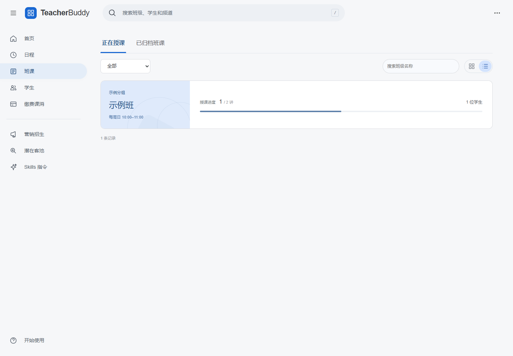

# 用 WorkBuddy 开始使用 TeacherBuddy

TeacherBuddy 和两个 Skills 免费开源，在自己的电脑运行，无需购买服务器或域名。WorkBuddy 的 AI 调用受账号免费额度限制，[以官方套餐为准](https://www.workbuddy.cn/pricing/)。

## 1. 安装 WorkBuddy

从 [WorkBuddy 官网](https://www.workbuddy.cn/) 下载电脑端，安装并登录。新建任务，选择存放教学工作台的文件夹。[官方安装图解](https://www.codebuddy.cn/docs/workbuddy/FirstTask)。

## 2. 复制下面的安装指令

把整段发给 WorkBuddy，无需自己输入命令：

```text
请帮我在这台电脑安装并启动 TeacherBuddy 教师工作台。我不懂代码，请你完成操作，只在确实需要我点击或补充信息时告诉我下一步。

项目：https://github.com/cregret/teacherbuddy
两个 Skills：https://github.com/cregret/teacherbuddy-skills

1. 在我选定的工作文件夹下创建 TeacherBuddy 目录。若目录已存在，先识别是否为已有安装，保留 .env 和 data，不覆盖我的资料。
2. 优先下载项目 Releases 最新版的 teacherbuddy.zip 并解压；不要用第三方镜像。发布包含构建资源，运行无需 npm install。检查 Node.js 是否为 22 或更新版本；没有时引导我从 https://nodejs.org/ 安装官方 LTS，不要求我填写 API Key、购买服务器或订阅。
3. 阅读项目 README.md 和 AGENTS.md。运行 npm run preview，让服务在后台持续运行，并打开实际输出的本机地址。Windows 的后台进程使用隐藏窗口；不要把带密码的正式服务公开到网络。首次安装从空工作区开始，不导入示例覆盖我的数据。
4. 从 Skills 仓库的最新 Release 下载 teacherbuddy-create-class.zip 和 teacherbuddy-after-class.zip。先核对各包内有对应目录及 SKILL.md，再使用 WorkBuddy 支持的上传技能入口安装，不猜测隐藏安装目录。若你无法替我点击，告诉我文件位置，并引导我在“专家·技能·连接器 → 技能 → 添加技能 → 上传技能”中分别上传这两个 ZIP。
5. 核对网页能打开，两个技能已启用；无法核实时明确告诉我，不要说已完成。给我留下项目文件夹位置和下次打开方式：Windows 双击“启动预览.cmd”；其他系统可以继续请你启动。
6. 最后问我班级名称、分组、学生名单和每周上课安排，使用“创建班级”技能开始。名单与课表核对后，我授权你备份并合并本工作区数据；需要导入时只停止和重启你为该工作区启动的服务，不能停止其他程序，不覆盖历史资料。
```

需要手动安装技能时，在「专家·技能·连接器 → 技能 → 添加技能 → 上传技能」中分别上传两个 ZIP，不要上传整个源码仓库 ZIP。[官方上传说明](https://www.codebuddy.cn/docs/workbuddy/From-Beginner-to-Expert-Guide/Function-Description/Skills-Market)。

- [下载 teacherbuddy-create-class.zip](https://github.com/cregret/teacherbuddy-skills/releases/latest/download/teacherbuddy-create-class.zip)
- [下载 teacherbuddy-after-class.zip](https://github.com/cregret/teacherbuddy-skills/releases/latest/download/teacherbuddy-after-class.zip)

## 3. 开始自己的教学工作

### 建立第一个班级

班课 · 学生 · 日程

```text
请使用“创建班级”技能，带我建立自己的第一个班级。先问班级名称、我自定义的分组、学生名单、每周上课时间和起止安排，一次只问当前缺的信息。先让我核对名单和具体课表，再备份、合并到我的 TeacherBuddy；若需要导入，可停止并重启你为这个工作区启动的服务，不要清空其他资料。
```

### 整理课后学情

课节报告 · 学生档案 · 重点关注

```text
请使用“课后学情整理”技能。先确认我这份资料对应的班级、日期、课节和学生名单，再整理班级学情报告、学生学情报告、重点关注和知识图谱。给每项判断注明来源，听不清或身份不明的不要猜。核对后备份并合并到我的 TeacherBuddy，保留历史记录；图谱文件单独保存。需要导入时只重启你为这个工作区启动的服务。
```

### 跟进招生咨询

潜在客池

```text
请根据我提供的咨询记录，整理潜在学员的课程需求、已沟通内容、当前进展和下一次联系安排，生成可核对的名单。只记录明确提供的信息，不猜电话、不替我发送消息。先让我核对，再按 TeacherBuddy 当前数据结构合并到潜在客池，保留原有跟进记录。
```

### 把课堂成果变成文章

营销招生

```text
请从我选定的一节课的真实记录中，制作一篇至少 600 字的招生文章草稿，写清适合什么学生、课堂如何解决问题、有哪些有证据的变化，并注明来源班级、课节与日期。搭配有权使用的图片；没有合适图片时给出配图建议，不冒用学生照片，不编造提分效果。去除学生个人信息，不自动发布。让我核对后按 TeacherBuddy 当前文章结构保存到营销招生草稿。
```



图中为合成示例；新安装从空工作区开始。建班后，可在班课中查看每周上课时间、授课进度和学生人数。

## 下次打开与保存

Windows 双击项目文件夹中的「启动预览.cmd」，或让 WorkBuddy 打开已有 TeacherBuddy。电脑需保持开机，本机服务才能访问。

数据在自己的电脑中。定期备份 data 与 .env，两者缺一不可，不上传到公开仓库。遇到问题，把报错发给 WorkBuddy 并说明“保留我的班级和学生记录”。

两个 Skills 分别处理建班和课后学情；招生与营销可使用 WorkBuddy 的通用能力及库中其他指令。生成草稿不等于已经导入或发送，写入后应在相应页面核对。完整知识图谱作为文件交付，当前页面显示知识点掌握表。
